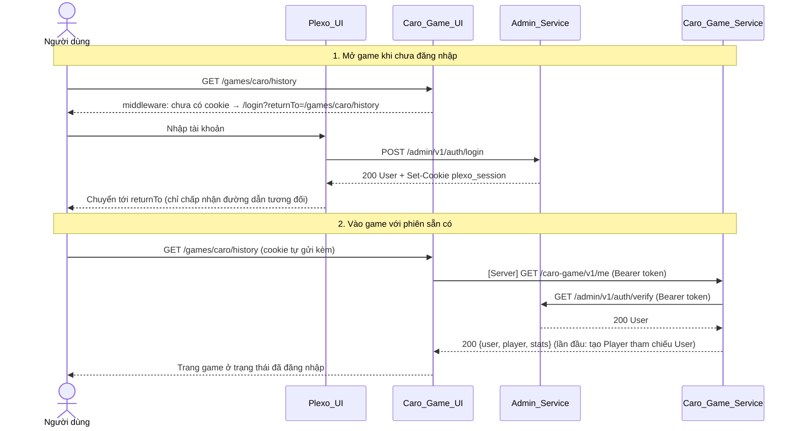

# Kiến trúc Plexo

Tài liệu kiến trúc tổng thể của hệ sinh thái Plexo (cập nhật sau Phase 1). Chi tiết từng thành phần nằm trong README của repo tương ứng; quy ước code chung nằm trong `.claude/CLAUDE.md` của workspace.

## 1. Thành phần

| Repository | Loại | Trách nhiệm | Route |
|---|---|---|---|
| `Plexo` | Tài liệu / DevOps | Tài liệu chung, docker-compose hạ tầng (`infrastructure/`) và deploy (`service/`) | — |
| `Admin_Service` | BE (Go) | Nguồn sự thật duy nhất về User; đăng ký / đăng nhập / đăng xuất / verify; danh sách ứng dụng mở rộng | `api.plexo.thanhldt.site/admin/v1` |
| `Caro_Game_Service` | BE (Go) | Game Caro: tham chiếu User, engine trận đấu, bot, hàng chờ / phòng, WebSocket, lịch sử, thống kê | `api.plexo.thanhldt.site/caro-game/v1` |
| `Notification_Service` | BE (Go) | Thông báo (chưa có nghiệp vụ) | `api.plexo.thanhldt.site/notification/v1` |
| `Plexo_UI` | FE (Next.js) | Ứng dụng chính: đăng nhập, đăng ký, danh sách ứng dụng mở rộng | `plexo.thanhldt.site/` |
| `Caro_Game_UI` | FE (Next.js) | Giao diện game Caro | `plexo.thanhldt.site/games/caro` |

```
              plexo.thanhldt.site (cùng origin)                     api.plexo.thanhldt.site
                ┌───────────────────────────────────────┐      ┌─────────────────────────────────────────────┐
 Người dùng ──▶ │ Traefik                               │      │ Traefik                                     │
                │  /games/caro/* ──▶ Caro_Game_UI :3000 │      │  /admin/*        ──▶ Admin_Service        :8000 │
                │  /*            ──▶ Plexo_UI     :3000 │      │  /caro-game/*    ──▶ Caro_Game_Service    :8000 │
                └───────────────────────────────────────┘      │  /notification/* ──▶ Notification_Service :8000 │
                                                               └─────────────────────────────────────────────┘
       Cookie plexo_session (httpOnly, SameSite=Lax, Domain=plexo.thanhldt.site) gửi kèm tới cả FE lẫn API (REST + WebSocket)

   Caro_Game_Service ──(network nội bộ, Bearer token của User)──▶ Admin_Service: verify, lấy thông tin User
   Admin_Service     ──▶ Postgres (plexo_admin)     + Redis (prefix admin:)
   Caro_Game_Service ──▶ Postgres (plexo_caro_game) + Redis (prefix caro:)
```

## 2. Routing

| | Prod (dev: thay `plexo` bằng `plexo-dev`) | Local (chạy trực tiếp, không Traefik) |
|---|---|---|
| Plexo_UI | `plexo.thanhldt.site/` | `http://localhost:3000` |
| Caro_Game_UI | `plexo.thanhldt.site/games/caro` | `http://localhost:3001/games/caro`, nên mở qua `localhost:3000/games/caro` (Plexo_UI chuyển tiếp bằng Next.js `rewrites`) để cùng origin như production |
| Notification_Service | `api.plexo.thanhldt.site/notification` | `http://localhost:8001/notification` |
| Admin_Service | `api.plexo.thanhldt.site/admin` | `http://localhost:8002/admin` |
| Caro_Game_Service | `api.plexo.thanhldt.site/caro-game` | `http://localhost:8003/caro-game` |

- BE: API nghiệp vụ dưới `/<service>/v1/...`; `/<service>/health`, `/<service>/docs` (OpenAPI tự sinh), `/<service>/openapi.json` không có version.
- FE: mọi ứng dụng cùng origin; ứng dụng chính ở root, game ở `/games/<game-name>` (Next.js `basePath`). Chuyển giữa các ứng dụng FE bằng điều hướng thường (thẻ `<a>`), không dùng router nội bộ.

## 3. Môi trường và triển khai

Domain `thanhldt.site` dùng chung cho mọi dự án cá nhân: mỗi app / môi trường một cặp host `<app>[-<env>].thanhldt.site` (FE) và `api.<app>[-<env>].thanhldt.site` (BE). Server không có IP công khai: traffic vào qua **Cloudflare Tunnel** (HTTPS do Cloudflare).

```
 Người dùng ──HTTPS──▶ Cloudflare ──Tunnel plexo-<env>──▶ cloudflared ──▶ Traefik ──▶ container của stack
```

- Mỗi môi trường là một **stack** (`STACK_NAME=<app>-<env>`) = một bản clone repo `Plexo` trên server với `.env` riêng: Postgres, Redis, Traefik, cloudflared và các service riêng. Traefik không mở port, chỉ nhận container có label `plexo.stack=<STACK_NAME>`; mọi tên container / network / router có tiền tố stack.
- Cookie phiên có domain = host FE của môi trường, nên phiên prod và dev không lẫn nhau (mỗi môi trường một Redis, token của môi trường này bị môi trường kia từ chối).

| | prod (`plexo-prod`, `/srv/app-prod/plexo`) | dev (`plexo-dev`, `/srv/app-dev/plexo`) |
|---|---|---|
| Nguồn | Tag `v*` tạo từ `main` | Nhánh `develop` |
| Image | `:vX.Y.Z`, `:latest`, `:<sha>` | `:develop-latest`, `:develop-<sha>` |
| Triển khai | Thủ công trên server (`docker compose pull && up -d`) | Tự động: job CI trên self-hosted runner `homelab-server-01` |

Hướng dẫn thiết lập (Cloudflare, GitHub organization `thanhldt-plexo`, server) và quy trình phát hành: `README.md`.

## 4. Xác thực và đăng nhập liên ứng dụng

- **Token**: 32 byte ngẫu nhiên (opaque) do `Admin_Service` sinh khi đăng nhập. Redis lưu phiên theo SHA-256 của token (`admin:session:<hash>`).
- **Hết hạn**: không dùng quá `session_idle_ttl` (mặc định 7 ngày, gia hạn mỗi lần verify), hoặc quá `session_max_age` (mặc định 30 ngày) kể từ lúc đăng nhập.
- **Vận chuyển**: cookie `httpOnly` dùng chung cho mọi ứng dụng FE (cùng origin) và gửi kèm tới API (cùng site). Service nhận token từ cookie hoặc `Authorization: Bearer` (Server Component của FE, service gọi service).
- **Verify**: `GET /admin/v1/auth/verify` trả đầy đủ thông tin User. Service khác verify mỗi request (và mỗi nước đi / mỗi 60s với WebSocket) bằng client chung `plexo-common/clients/admin`.
- **Đăng xuất**: xóa phiên trong Redis → mọi ứng dụng mất phiên ngay ở request tiếp theo; WebSocket đang mở bị đóng (mã `4401`) chậm nhất ~60 giây.
- **Chưa có phân quyền**: API ghi dành cho quản trị (`extension-apps`) yêu cầu header `X-Admin-Key` (giá trị trong `config.json`).
- **CSRF / WebSocket hijacking**: `SameSite=Lax` + CORS chỉ cho phép origin cấu hình (kèm credentials); WebSocket kiểm tra header `Origin` trước khi upgrade.



## 5. Dữ liệu

Mỗi môi trường (stack) một instance Postgres và một instance Redis, dùng chung cho các service của môi trường đó; mỗi service một database + user Postgres và một ACL user + prefix Redis riêng. Không service nào đọc dữ liệu của service khác: trao đổi qua API.

| Service | Postgres (database: bảng) | Redis (prefix: nội dung) |
|---|---|---|
| Admin_Service | `plexo_admin`: `users`, `extension_apps` | `admin:`: phiên đăng nhập |
| Caro_Game_Service | `plexo_caro_game`: `players` (tham chiếu `user_uuid`), `matches`, `match_moves` | `caro:`: trận đang chơi, hàng chờ, phòng |

- ID: UUID v7 sinh trong Go. Migration SQL nằm trong repo của service, tự chạy khi khởi động.
- Trận đang chơi chỉ nằm trong Redis; kết thúc mới ghi vào Postgres (một transaction) rồi xóa khỏi Redis. Restart service giữa trận không mất trận: trạng thái được khôi phục và đặt lại hẹn giờ lượt.

## 6. Realtime (Caro)

- WebSocket `wss://api.plexo.thanhldt.site/caro-game/v1/ws`; một kết nối mỗi tab trình duyệt.
- Message JSON `{type, id, payload}` / `{type, reply_to, payload}`; chơi với bot và chơi online dùng chung một engine và một giao thức. Danh sách message: README của `Caro_Game_Service`.
- Client tự kết nối lại (1s → 10s) rồi đồng bộ (`match.sync`); đồng hồ lượt chạy phía server.

## 7. Kiến trúc code

- **BE (Go 1.26)**: chia theo tầng `model / dto / service / repository (db, redis…) / api/v1`, phụ thuộc qua interface, inject trong `internal/app`. Huma v2, bun, `log/slog`, lỗi RFC 9457 kèm `code`, JSON snake_case. Code hạ tầng dùng chung ở `common/` (module `plexo-common`) giống hệt ở mọi service.
- **FE (Next.js 15)**: App Router, Atomic Design (`components/atoms|molecules|organisms|templates`, ESLint chặn import ngược tầng), logic theo tính năng ở `features/<tính năng>`, react-query, next-intl (vi / en, locale lưu ở cookie), Tailwind CSS 3.

## 8. Giới hạn hiện tại

- `Caro_Game_Service` chạy **một instance**: khóa trận, hẹn giờ lượt và kết nối WebSocket nằm trong bộ nhớ của instance. Muốn chạy nhiều instance cần khóa / pub-sub qua Redis.
- Trận lưu Postgres lỗi chỉ được thử lại khi service khởi động lại.
- Biến `NEXT_PUBLIC_*` của FE được gắn vào bundle lúc build, nên image FE gắn với một môi trường: CI build riêng cho dev (`develop`) và prod (tag `v*`), không dùng lại image dev cho prod.
- Chưa có phân quyền; API thống kê chỉ yêu cầu đăng nhập.
